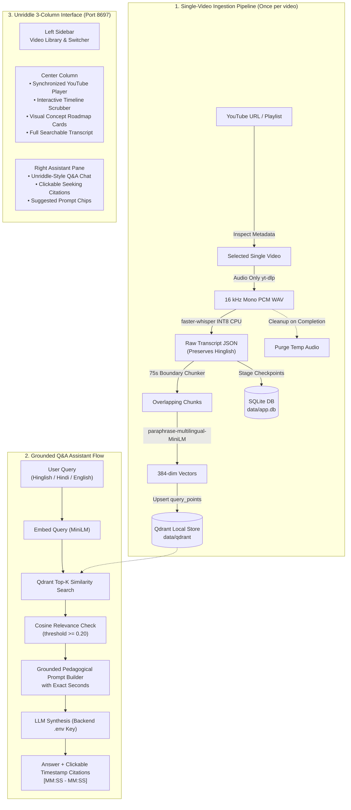
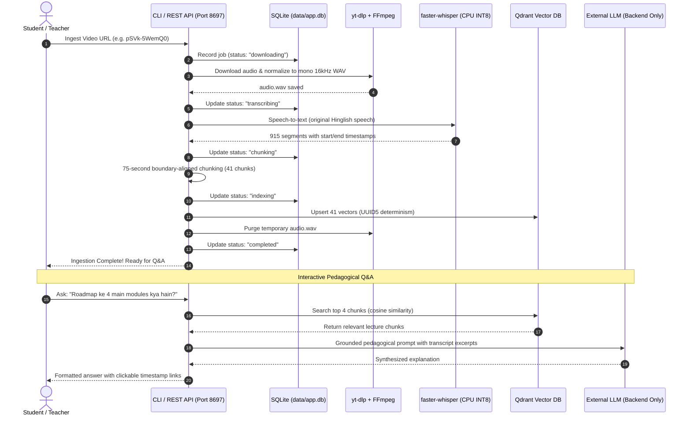

# Hinglish YouTube Lecture AI Teaching Assistant (CPU-First RAG)

[](https://www.python.org/)
[](https://fastapi.tiangolo.com/)
[](https://qdrant.tech/)
[](https://github.com/SYSTRAN/faster-whisper)
[-ee4c2c.svg?logo=pytorch&logoColor=white)](https://pytorch.org/)
[](http://localhost:8697)
[](http://localhost:8697)

A practical, low-resource Retrieval-Augmented Generation (RAG) teaching assistant that converts selected YouTube lecture videos (English, Hindi, and Hinglish) into an indexed, searchable knowledge base.

Designed specifically for **CPU-only laptops with limited RAM (~3.5 GiB)**:
- Processes **one selected video at a time**.
- Downloads audio only and normalizes via **FFmpeg** (mono 16 kHz PCM WAV).
- Hinglish speech-to-text with **faster-whisper** on CPU INT8 preserving original spoken code-switching (no forced translation).
- **75-second timestamp-aware chunking** respecting sentence and speech boundaries.
- **Multilingual MiniLM** sentence embeddings (`paraphrase-multilingual-MiniLM-L12-v2`, 384 dimensions).
- Persistent local **Qdrant** vector store (no Docker required).
- Relational ingestion job tracking via local **SQLite** (`data/app.db`).
- Grounded pedagogical answer generation with **exact, verified clickable YouTube timestamp links** (`https://www.youtube.com/watch?v=VIDEO_ID&t=123s`).
- Modern **Unriddle-style 3-column UI** with visual roadmap cards, timeline scrubber, synchronized YouTube player, interactive transcript, and grounded AI chat.
- External LLM API key stays isolated in backend `.env` (never exposed to browser, logs, or responses).

---

## Visual Architecture & Workflow



### Ingestion Sequence & Checkpoint State Flow



---

## Directory Structure

```
.
├── app/
│   ├── __init__.py
│   ├── config.py          # .env settings, models, paths, and constants
│   ├── storage.py         # SQLite job state and stage transitions
│   ├── media.py           # yt-dlp metadata & audio download + FFmpeg normalization
│   ├── transcription.py   # faster-whisper CPU INT8 Hinglish transcription
│   ├── retrieval.py       # 75s chunking, MiniLM embeddings, Qdrant upsert/search
│   ├── teaching.py        # Grounded prompts, LLM call, clickable citations
│   ├── ingest.py          # End-to-end single video ingestion orchestrator
│   ├── cli.py             # Full-featured command-line interface
│   └── main.py            # FastAPI REST API + embedded single-page UI (Port 8697)
├── data/                  # Local runtime data (ignored in git)
│   ├── audio/             # Temporary media (purged after indexing)
│   ├── transcripts/       # Durable raw & chunk JSON checkpoints
│   ├── qdrant/            # Persistent local Qdrant vectors
│   └── app.db             # SQLite database
├── tests/
│   ├── test_chunking.py
│   ├── test_timestamps.py
│   ├── test_ingestion_state.py
│   └── test_retrieval.py
├── .env.example
├── .gitignore
├── requirements.txt
├── PRD.md
├── idea.md
└── README.md
```

---

## Quickstart

### 1. Prerequisites
- Python 3.10+
- FFmpeg installed and in PATH (`ffmpeg -version`)

### 2. Environment Setup
```bash
python3 -m venv .venv
source .venv/bin/activate
pip install -r requirements.txt
```

### 3. Configure `.env`
```bash
cp .env.example .env
# Edit .env to add your LLM API Key (OpenAI, Gemini OpenAI-compatible, Groq, etc.)
```
*Note: Ingestion, ASR transcription, chunking, and vector search work completely offline without an LLM key. The external key is only required for generative pedagogical synthesis.*

---

## Usage

### Command Line Interface (CLI)

```bash
# 1. Inspect a YouTube video or playlist without downloading media
python -m app.cli inspect "https://youtu.be/pSVk-5WemQ0"

# 2. Ingest one selected video
python -m app.cli ingest "https://youtu.be/pSVk-5WemQ0"

# 3. List indexed lectures
python -m app.cli list

# 4. Ask a question (supports English, Hindi, and Hinglish)
python -m app.cli ask "GenAI roadmap mein deep learning ke concepts kahan se padhein?" --video-id pSVk-5WemQ0
```

### Web Interface & FastAPI Server (Port 8697)

Start the Uvicorn server on **port 8697**:

```bash
uvicorn app.main:app --host 0.0.0.0 --port 8697 --reload
```

Open your browser to:
👉 **[http://localhost:8697](http://localhost:8697)**

#### Web UI Highlights (Unriddle 3-Column Experience):
- **Synchronized Video Player**: YouTube iframe embeds dynamically and jumps directly to the timestamp when any citation or timeline chip is clicked.
- **Interactive Timeline Scrubber**: Color-coded lecture milestones (Intro, ML Basics, GenAI Landscape, LLM Foundations, 4-Stage Roadmap, Project Strategy).
- **Visual Concept Roadmap Cards**: Direct lecture navigation cards for key architectural topics.
- **Searchable Transcript**: Full code-switched transcript with millisecond-precision timestamps.
- **Pedagogical Assistant**: Conversational assistant with pre-loaded prompt chips and exact citation pills.

---

## Running Tests

```bash
pytest -v
```

